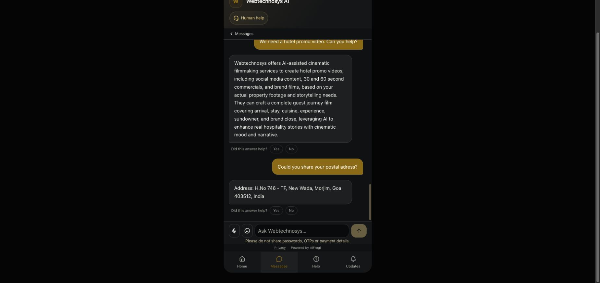

# Deployed corrections: live test and remaining work

**Live release `rag-fc09918`, source commit `fc09918`, build `-cDrJqJsCXrWCUeKgQUBO`.** Deployed on 3 October 2026 at approximately 4:22 PM IST, following the user's explicit request to deploy and inspect the remaining issues. This request followed the failed candidate review; this deployment is not represented as a fully passed answer-quality gate.

The existing `lead-os-ai` application was restarted. All ten deployed runtime source files match the approved local source hashes. Readiness is healthy. No crawling, workbook edits, new FAQs, knowledge activation, schema, tenant permissions or payment connectors were changed. Other PM2 applications were not restarted.

| Verification | Result |
|---|---|
| Regression / isolated service-failure tests before deployment | 847/847; 13/13 |
| New isolated build | Passed |
| Readiness and deployed source identity | Passed; ten matching source hashes |
| Original 15 unchanged raw signal checks | 15/15, but source review finds failures below |
| All 30 unchanged public question raw signal checks | 27/30 |
| Exact response-to-receipt source bindings | 30/30 |
| Total response latency, same public HTTPS path as baseline | Median 3.54s; p95 5.81s; maximum 7.61s |
| Chrome | Hotel-video question and typo-address question answered; screenshot saved |

Raw 27/30 is a keyword diagnostic, not 90% factual accuracy, customer resolution or an industry rating. In particular, raw checks miss the privacy assurance and video-format binding failures. The test questions and acceptance signals were not changed. No answer was rewritten to make a result pass.

## What works and what remains

| Area / cases | Live finding | Next correction |
|---|---|---|
| Address, phone, email — #8, #16–18 | Approved contact values returned; address typo handled. Public address 0.51s, phone 0.32s, email 0.54s | Retain exact source extraction |
| iPhone follow-up — #22 | Resolves previous app subject and returns iOS/Android capability | Retain conversation resolution |
| Hotel-video request — #20 | Clear capability answer without the previous unrelated unconditional-commitment uncertainty | Correction verified in this run; continue broader request-binding tests |
| Privacy/NDA — #24 | **Incorrectly stronger assurance**: “does not share project ideas publicly” and “ensuring … remain private” | Highest priority: bind actor, policy condition and claim strength to exact source statements. NDA capability is not an absolute sharing/privacy guarantee |
| Video format labels — #1 and Chrome video reply | Calls both 30/60-second outputs commercials; source labels 30-second commercial and 60-second brand film | Bind numbers to the exact named format, not merely matching numbers in the paragraph |
| Exact price — #14 | Contact-only fallback omits the existing scope-dependent/on-request pricing policy | Preserve useful published limitations alongside genuinely missing numerical quotes |
| Driver-app capability — #21 | Generic capability supported, but available iOS/Android names omitted | Complete requested capability from evidence; do not patch one question |
| Per-shoot count — #27 | No invented numerical yield, but published packages 10/25 omitted; “requested per-unit quantity” is awkward | Explain supported package counts in their original context and identify only the absent per-shoot relation |
| Default clarity — #1, #3, #4, #19 | Long/process-heavy replies and repeated booking information remain | Keep minimum requested facts without hard rejection/truncation |
| Outcome and uncertainty — #10, #11, #28 | Some qualification/modality is weakened or omitted; revenue fallback misses a useful published general results limitation | Preserve conditions and distinguish a requested missing fact from unasked draft detail |
| Raw failures — #21, #26, #27 | #21/#27 omit expected facts. #26 is factually supported scope-dependent pricing despite word-matcher failure | Keep the raw result and separate source review; do not rewrite tests to improve the score |

## Missing business information, separately

Exact weekend/office hours, bootcamp refund terms, explicit Microsoft certification and a guaranteed numerical yield per shoot are not established in the reviewed authorised evidence. #25, #29 and #30 returned approved contact details with specific missing topics, without inventing information. Existing NDA safeguards, application platforms, pricing limitations, package counts and general revenue-results limitations already exist; their omission is an engine issue, not a reason to crawl again.

Training pages describe Friday and Saturday cohorts. The live general-offerings answer volunteers cohort months, but does not resolve that source discrepancy. Owner confirmation is required before answering a single current schedule as certain.

## Actual answers, evidence and Chrome

[All 30 actual replies and per-stage latency table](ANSWERING_234_DEPLOYED_REPLIES_2026-10-03.md). [Complete production results](ANSWERING_234_DEPLOYED_RESULTS_2026-10-03.json) include each actual response, exact delivery receipt, retrieved full passages, source versions, claim citations, correctness assessment, persisted outcome and per-stage/total timing. Model-request durations are child timings and must not be added again to the pipeline stage totals.

[Build log](ANSWERING_234_DEPLOYED_BUILD_2026-10-03.log), [readiness/source verification](ANSWERING_234_DEPLOYED_VERIFICATION_2026-10-03.txt), [Chrome visible text](ANSWERING_234_DEPLOYED_CHROME_2026-10-03.txt).

Chrome returned the exact address after “Could you share your postal adress?”. The hotel-video reply no longer had the unasked uncertainty, but did contain the same 30/60-commercial wording error. Both findings are retained. Existing older chat history was not rewritten; the screenshot is scrolled to the new test turns. No phone call, callback request or payment was initiated.

## Rollback

The previous source/build and release identity are retained at `/var/backups/aifrogi-answering-fc09918-20261003`. The [saved rollback script](ANSWERING_234_DEPLOYED_ROLLBACK_2026-10-03.sh), also stored there as `rollback.sh`, restores source/build `7c395d4`, removes only new helper files that were absent before deployment, restarts only `lead-os-ai` with `rag-7c395d4`, and checks readiness. It preserves business data and new conversations. Syntax was checked; a production rollback was not executed. Repeat the same public gate after rollback.

The release remains live as requested. These observed grounding/completeness failures are unresolved; neither the passing regression suite nor service health establishes reliable answers to all visitor questions.
