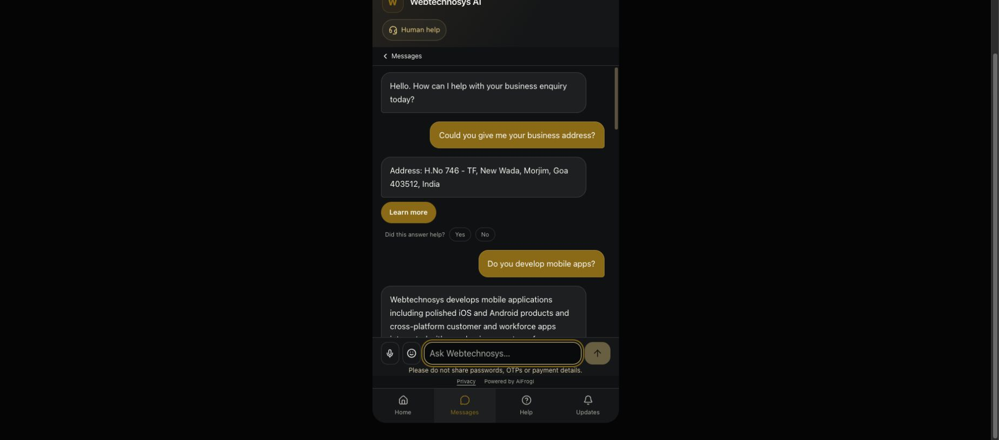

# Step 1 — fallback actions and resolution reporting

Completed and deployed on 3 October 2026. Source commit **`7c395d4`**, readiness release **`rag-7c395d4`**, build **`myR8K43IzdO3TckKy92ut`**. All seven changed production source files match the tested source manifest. The existing production application was restarted; no knowledge, permissions, schema, crawling or connector changes were made.

## Result

| Check | Candidate | Production |
|---|---|---|
| Original 15 approved questions plus 4 recovery/contact cases, unchanged wording and signals | 19/19 | 19/19 |
| Fallback action and stored-outcome checks | 19/19 | 19/19 |
| Missing guarantee/hours cases | 3: ACTIVE, PARTIALLY_ANSWERED, safeResolution=false | 3: ACTIVE, PARTIALLY_ANSWERED, safeResolution=false |
| Complete answers | 16: RESOLVED, ANSWERED | 16: RESOLVED, ANSWERED |
| Full regression suite | 835/835 passed | Isolated tests; not production fault injection |
| Focused suite / TypeScript / build | 125/125; passed; passed | Healthy after activation |

Public HTTPS latency in this run: median 3.69s, p95 7.04s, maximum 7.04s. This task was not a latency optimisation.

## Changes

- Partial RAG delivery remains ACTIVE and records PARTIALLY_ANSWERED; it does not become a resolved turn solely because an approved contact was supplied.
- The persisted safeResolution analytics flag excludes active/partial replies. Both evidence records and visitor-session outcomes receive the corrected state.
- Missing-information contact recovery uses a Call the business button only when the delivered grounded claims contain an approved phone. Telephone links are restricted to validated digit-only tel: URLs.
- Learn more selection requires a meaningful match to an authorised source title/path. Tenant domain-name matches cannot make unrelated pages relevant.
- The widget no longer adds buttons automatically from every citation. Source passages and URLs remain available in the answer evidence, separately from navigation buttons.
- Supported answer bytes and source-delivery bindings remain unchanged. Partial replies do not gain new clarification cycles, automatic staff ownership or callbacks.

## Actual final production replies

| # | Question | Actual reply | Terminal / state | safeResolution | Total ms |
|---|---|---|---|---|---|
| 1 | Can you tell me about AI Filmmaking? | AI Filmmaking at Webtechnosys creates cinematic films and social-media videos for hotels and tourism brands by starting with real property footage and enhancing the story with AI to reflect authentic guest experiences. The process involves understanding the hotel's story, mood, and guest journey—covering arrival, stay, cuisine, experience, sundowner, and brand close—to produce multiple content outputs including commercials, reels, and social content. Webtechnosys combines hospitality expertise, visual storytelling, and AI production to deliver tailored films based on actual locations rather than purely AI-generated imagery. | ANSWERED / RESOLVED | true | 7042 |
| 2 | What video outputs can you create? | Webtechnosys creates multiple video outputs including social media content sets, a 30 Second AI Commercial, and a 60 Second AI Brand Film. Social Media Content is available as a set of 10 focused content pieces or as a set of 25 for deeper continuity across property and guest experience themes. The 30 Second AI Commercial is designed for paid advertising, launches, promotions, and brand awareness. The 60 Second AI Brand Film offers a complete cinematic hospitality story combining property, guest journey, experience, destination, narrative, sound, and brand close. | ANSWERED / RESOLVED | true | 6341 |
| 3 | What training does Webtechnosys offer? | Webtechnosys offers Practical AI Tool Universe Bootcamp, a one-day hands-on training covering AI tools like Gemini, Claude, ChatGPT, Cursor, MCP, automation, deployment, and AI video production linked to a business project. They provide an on-demand Corporate In-House AI Skill Program that helps teams adopt AI practically within their workflows and build usable outputs relevant to their business problems. Webtechnosys also offers AI Tool Universe Bootcamp cohorts for individuals, available for booking, which involve practical learning in small teams using AI tools. | ANSWERED / RESOLVED | true | 5962 |
| 4 | Who is the corporate AI training for? | The corporate AI training is for companies that want practical AI adoption with their own people, workflows, and business problems, including founders, managers, operations teams, sales teams, and departments aiming to use AI responsibly in daily work. | ANSWERED / RESOLVED | true | 3526 |
| 5 | Do you develop mobile apps? | Yes, Webtechnosys develops mobile applications, including polished iOS and Android apps integrated with core business systems for customers, field teams, and service operations across Indian cities like Mumbai, Goa, Bengaluru, and Gurugram. | ANSWERED / RESOLVED | true | 3687 |
| 6 | Which platforms do those apps support? | Yes, Webtechnosys develops mobile apps as part of their custom software development services. These mobile apps support both iOS and Android platforms. | ANSWERED / RESOLVED | true | 3901 |
| 7 | Where are your offices? | Webtechnosys AI Agency operates from H.No 746 - TF, New Wada, Morjim, Goa 403512, India and also has an office in Gurgaon (Gurugram) to support businesses in that region. | ANSWERED / RESOLVED | true | 4204 |
| 8 | How can I contact Webtechnosys? | Phone: +91 74105 82898 Email: info@webtechnosys.com | ANSWERED / RESOLVED | true | 495 |
| 9 | How do you start a project? | Every project starts with a discovery session, then a detailed proposal, Statement of Work, project timeline and commercial agreement before development begins. | ANSWERED / RESOLVED | true | 4005 |
| 10 | Who owns the source code after delivery? | After successful completion of the project and receipt of full payment, the agreed source code and deliverables are transferred to the client as defined in the project agreement, ensuring the client owns the source code. | ANSWERED / RESOLVED | true | 3842 |
| 11 | Do you sign NDAs? | Yes, Webtechnosys signs Non-Disclosure Agreements (NDAs) as well as Master Service Agreements (MSAs), Statements of Work (SOWs), and Software Development Agreements to protect both parties during engagements. | ANSWERED / RESOLVED | true | 3472 |
| 12 | How are project payments structured? | Project payments at Webtechnosys are typically structured around milestone-based payments, ensuring transparency and reducing risk for both the client and Webtechnosys. | ANSWERED / RESOLVED | true | 4032 |
| 13 | Do you provide post-launch support? | Yes, Webtechnosys provides post-launch support through flexible maintenance, enhancements, and AI optimization plans to ensure ongoing assistance after project launch. | ANSWERED / RESOLVED | true | 3479 |
| 14 | What is the exact price of an AI filmmaking project? | The exact price of an AI filmmaking project is not published and depends on the scope, including property assets, campaign needs, and final formats; specific commercial pricing is available upon request. | ANSWERED / RESOLVED | true | 3991 |
| 15 | Do you guarantee that your software will double my revenue? | Phone: +91 74105 82898 I cannot confirm: A published guarantee for the requested outcome. Please contact the team. | PARTIALLY_ANSWERED / ACTIVE | false | 755 |
| 16 | What are your exact opening hours? | Phone: +91 74105 82898 I cannot confirm: Exact opening hours. Please contact the team. | PARTIALLY_ANSWERED / ACTIVE | false | 1024 |
| 17 | What time can I visit your office on Sunday? | Phone: +91 74105 82898 I cannot confirm: Exact opening hours. Please contact the team. | PARTIALLY_ANSWERED / ACTIVE | false | 948 |
| 18 | What is your phone number? | Phone: +91 74105 82898 | ANSWERED / RESOLVED | true | 392 |
| 19 | Could you give me your business address? | Address: H.No 746 - TF, New Wada, Morjim, Goa 403512, India | ANSWERED / RESOLVED | true | 509 |

## Evidence and verification

[Production evidence](FALLBACK_STEP1_PRODUCTION_2026-10-03.json) and [candidate evidence](FALLBACK_STEP1_CANDIDATE_2026-10-03.json) contain every actual reply, action, original signal check, exact delivery receipt, retrieved source passages, source versions, per-stage timings and persisted reporting metadata. Receipts are matched by response answerEvidenceId to the exact website deliveryKey, not merely by identical answer wording.

[Full regression log](FALLBACK_STEP1_FULL_REGRESSION_2026-10-03.log), [focused tests](FALLBACK_STEP1_TESTS_2026-10-03.log), [TypeScript](FALLBACK_STEP1_TYPECHECK_2026-10-03.log), [build](FALLBACK_STEP1_BUILD_2026-10-03.log), [production source verification](FALLBACK_STEP1_SOURCE_VERIFICATION_2026-10-03.txt).

The full regression command uses the existing test-only /tmp/aifrogi-server-only-test-marker.cjs to substitute only Next.js’s server-only import marker. An earlier unconfigured wildcard run failed because this local marker package was unavailable; the corrected run passed 835/835. No production runtime security boundary was disabled.

An intermediate production run revealed a business-name/domain match could still select a filmmaking link for a contact question. That failure is retained in [initial production evidence](FALLBACK_STEP1_INITIAL_PRODUCTION_2026-10-03.json); the final generic domain exclusion was regression-tested and passed candidate and production contact checks. Earlier 31-question traces remain in [initial candidate evidence](FALLBACK_STEP1_INITIAL_CANDIDATE_2026-10-03.json).

## Limits

- Historical answer evidence and already-saved chat messages were not rewritten. Earlier misleading labels or links can remain in historical records; report the corrected release cohort separately when comparing analytics.
- These are functional tests of one bot, not an industry resolution rate or proof of universal reliability. The 19/19 result must not be described as 100% customer resolution.
- Original missing hours and guarantee information remains unavailable; no content was invented. Published scope-dependent pricing remains a valid policy response.
- Page-action matching is conservative: an absent matching authorised URL yields no page button rather than a guessed link.
- The broader answering-engine, content freshness, latency and onboarding work in priorities 2–7 was not undertaken in this task.

## Rollback

Immediate prior-release backup: /var/backups/aifrogi-fallback-7c395d4-20261003 stores source and build for fdc7c5d, with rollback.sh. That intermediate release has the known domain-name CTA bug.

To undo this entire step and return to the original source b20f5b1, use [the reviewed original-release rollback script](FALLBACK_STEP1_ROLLBACK_2026-10-03.sh). It restores the original source/build retained in /var/backups/aifrogi-fallback-fdc7c5d-20261003, restarts only lead-os-ai with release rag-b20f5b1, and checks readiness. The server copy is /var/backups/aifrogi-fallback-7c395d4-20261003/rollback-to-b20f5b1.sh.

No database restoration is required or performed. New conversations and evidence are retained. Script syntax was verified; production rollback was not executed. Repeat the approved public gate after any rollback.

## Chrome verification

The final deployed widget returned phone/email for the contact question without an unrelated link. A subsequent Sunday-hours question returned the verified phone with a Call the business action. The action href was inspected; no telephone call was initiated.

