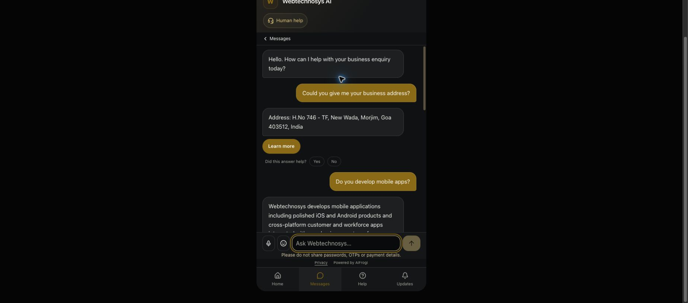

# AiFrogi RAG production release — 3 October 2026

Implemented and deployed source commit **`b20f5b1`** to the existing AiFrogi server. Readiness identifies **`rag-b20f5b1`**, build **`0AjpPG09T1r_M8GhOqjIW`**. The public bot was tested through HTTPS and Chrome. All 42 changed deployment source files match the committed candidate. Only the existing `lead-os-ai` application was restarted.

[Open the production bot](https://app.aifrogi.com/bot/webtechnosys-fresh-ai-bot-03e89f).

## Release result

| Measure | Observed result |
|---|---|
| Original 15 questions | 14/15 unchanged keyword checks; 14 supported replies plus 1 appropriate missing-guarantee response on manual source review |
| Extra contact, follow-up and missing-hours cases | 6/6 unchanged keyword checks |
| Ten additional questions | 7/10 unchanged keyword checks; all source-reviewed responses acceptable |
| Complete 31-question run | **27/31 unchanged keyword checks (87.1%)**; manual review: **28 source-supported replies, 3 safe missing-information responses, 0 unsupported replies observed** |
| Final isolated candidate | 31/31 keyword checks and manual source review acceptable; production wording differed |
| Regression tests | 829/829 passed; typecheck and production build passed |
| Public and indexing roles | Correct organisation accepted; wrong organisation denied for both roles |
| Existing knowledge index | 62 approved public workbook rows indexed; second run indexed 0; no new crawl or content |
| Full HTTPS answer latency | Median **3.78s**, p95 **5.32s**, maximum **7.12s** |
| Rollback validation | Prior-function restoration and encrypted backup restore rehearsed on isolated databases; production rollback was not exercised |

Manual review is separate from the unchanged keyword checker. The reported production gate is therefore not an unqualified 31/31 automated pass. Questions and expected signals were retained. No claim is made that this small, single-brand run proves 100% reliability.

## Changes and why

| Change | Purpose |
|---|---|
| One shared RAG execution and delivery path | Avoid competing policy/RAG answering flows, with tenant-scoped authority and delivery receipts |
| Approved claim embeddings plus lexical retrieval | Retrieve workbook and existing crawl evidence using meaning as well as words; backfill existing approved publications |
| Retain strongest admitted semantic service passages | Prevent beneficiary words such as hotel from discarding relevant filmmaking services |
| Resolve follow-ups before retrieval | Use recent conversation context for questions such as whether an application works on iPhones |
| Direct grounded business fields | Return approved phone, email and address quickly; distinguish visiting time from location |
| Formatting preference for length | Keep supported answers rather than rejecting them solely for length |
| Numeric product-label guard | Prevent a 60-second brand-film duration from being presented as a 60-second commercial |
| Capability and relevance instructions | Answer whether the business can provide a service rather than composing unrelated promotional copy |
| Optional-stage fallbacks | Preserve permitted retrieval when ranking fails; recover with verified business contact when generation or verification fails |
| One composition and batch support check | Avoid regeneration loops, per-sentence model calls and retries |
| Source authority, publication versions and delivery recheck | Exclude private, expired, future and wrong-tenant evidence and bind each reply to its admitted sources |

Scope: existing Webtechnosys-authorised crawl and the 62 publicly approved workbook rows. No new crawling, question-specific canned answers, new FAQs, payment transactions or connector activation. No new permanent service was added.

## Actual production replies

The table records every answer as returned; complete retrieved passages, source versions, receipts and stage timings are in [the production evidence JSON](RAG_RELEASE_FINAL_PRODUCTION_2026-10-03.json). S means manually source-supported; M means appropriate missing-information recovery. K is the unchanged keyword check.

| # | Question | Actual reply | Review / K | Total s |
|---|---|---|---|---|
| 1 | Can you tell me about AI Filmmaking? | We create cinematic AI films, commercials and social-media videos in Goa for hotels, resorts, tourism brands, properties and local businesses. AI Filmmaking creates cinematic films and commercials starting with actual hotel property footage, emphasizing real architecture, guest experiences, and storytelling to evoke emotions like privacy or celebration. The process involves planning the guest journey through stages such as arrival, stay, cuisine, experience, sundowner, and brand close, using AI to enhance mood and atmosphere without losing the property's identity. AI Filmmaking produces multiple content formats like social media reels, campaign cuts, and brand films by combining hospitality knowledge, visual storytelling, and practical AI production techniques. | S / PASS | 7.124 |
| 2 | What video outputs can you create? | Webtechnosys offers multiple video outputs from a single AI filmmaking story, including sets of social media content with 10 or 25 focused videos for regular posts, campaigns, and promotions. They produce a 30-second AI commercial designed for paid advertising, hotel launches, and brand awareness campaigns. They also create a 60-second AI brand film, a full cinematic hospitality story combining property visuals, guest journey, narrative, sound, and brand close. | S / PASS | 5.319 |
| 3 | What training does Webtechnosys offer? | Webtechnosys offers a Practical AI Tool Universe Bootcamp, a one-day hands-on training covering tools such as Gemini, Claude, ChatGPT, Cursor, MCP, automation, deployment, and AI video production through one live project. They also provide an on-demand Corporate In-House AI Skill Program aimed at practical AI adoption, workflow experiments, and team training customized to company contexts and real business problems. Open seat bookings are available for their AI Tool Universe Bootcamp Saturday cohorts, with payment handled securely online. | S / PASS | 4.897 |
| 4 | Who is the corporate AI training for? | The corporate AI training from Webtechnosys is designed for company teams including founders, managers, operations teams, sales teams, and departments aiming to adopt AI practically and responsibly in their daily workflows. | S / PASS | 3.622 |
| 5 | Do you develop mobile apps? | Yes, Webtechnosys develops mobile apps including cross-platform customer and workforce apps, polished iOS and Android products, and mobile applications integrated with core business systems across multiple Indian cities including Mumbai, Goa, Bengaluru, and Gurugram. | S / PASS | 4.077 |
| 6 | Which platforms do those apps support? | Yes, Webtechnosys develops mobile apps that are polished and tailored for iOS and Android platforms, supporting customers, field teams, and service operations. They specialize in cross-platform mobile product development integrated with core business systems for Indian businesses across Mumbai, Goa, Bengaluru, and Gurugram. | S / PASS | 4.142 |
| 7 | Where are your offices? | Webtechnosys operates remotely from Goa, India, without a physical office in Mumbai, and also maintains an office in Gurugram to support NCR businesses. | S / FAIL | 4.717 |
| 8 | How can I contact Webtechnosys? | Phone: +91 74105 82898 Email: info@webtechnosys.com | S / PASS | 0.527 |
| 9 | How do you start a project? | Every project at Webtechnosys starts with a discovery session and is followed by a detailed proposal, Statement of Work, project timeline, and commercial agreement before development begins. | S / PASS | 3.780 |
| 10 | Who owns the source code after delivery? | After successful project completion and full payment, the agreed source code and deliverables are transferred to the client, granting them ownership unless otherwise specified in the agreement. | S / PASS | 4.301 |
| 11 | Do you sign NDAs? | Webtechnosys signs Non-Disclosure Agreements (NDAs) along with Master Service Agreements, Statements of Work, and Software Development Agreements to protect both parties in their projects. | S / PASS | 3.417 |
| 12 | How are project payments structured? | Project payments at Webtechnosys are typically structured around milestone-based payments, which ensures transparency and reduces risk for both the client and the company. | S / PASS | 3.769 |
| 13 | Do you provide post-launch support? | Yes, Webtechnosys provides post-launch support that includes maintenance, enhancements, and AI optimization through flexible support plans. | S / PASS | 4.305 |
| 14 | What is the exact price of an AI filmmaking project? | The exact price of an AI filmmaking project is not publicly listed and depends on the property's assets, campaign needs, and final formats, with commercial pricing provided on request. | S / PASS | 3.964 |
| 15 | Do you guarantee that your software will double my revenue? | Phone: +91 74105 82898 I cannot confirm: A published guarantee for the requested outcome. Please contact the team. | M / PASS | 1.207 |
| 16 | What is your phone number? | Phone: +91 74105 82898 | S / PASS | 0.445 |
| 17 | Could you give me your business address? | Address: H.No 746 - TF, New Wada, Morjim, Goa 403512, India | S / PASS | 0.589 |
| 18 | What is your email address? | Email: info@webtechnosys.com | S / PASS | 0.466 |
| 19 | Do you develop mobile apps? | Yes, Webtechnosys develops mobile apps including cross-platform customer and workforce apps integrated with core business systems, polished iOS and Android products, and mobile applications for sales, service, bookings, and internal operations across Mumbai, Goa, Bengaluru, and Gurugram. | S / PASS | 4.814 |
| 20 | Can it also run on iPhones? | Webtechnosys develops mobile applications that run on both iOS and Android platforms for customers, guests, field teams, and service operations. | S / PASS | 4.617 |
| 21 | What are your exact opening hours? | Phone: +91 74105 82898 I cannot confirm: Exact opening hours. Please contact the team. | M / PASS | 1.096 |
| 22 | What is the street address of your Goa business? | Address: H.No 746 - TF, New Wada, Morjim, Goa 403512, India | S / PASS | 0.694 |
| 23 | Where should I email our project proposal? | Email: info@webtechnosys.com | S / PASS | 0.921 |
| 24 | Can you train our operations team to use AI at work? | Webtechnosys offers an on-demand Corporate In-House AI Skill Program to train your operations team in practical AI adoption, workflow experiments, and applied team training using your company’s real work context and processes. | S / PASS | 3.637 |
| 25 | Can you make a short AI advertisement for our hotel? | Webtechnosys offers AI-assisted cinematic production services for hotels, including short 30-second AI commercials designed for campaigns, launches, packages and brand awareness that build an emotional guest journey using real hospitality moments. | S / FAIL | 4.016 |
| 26 | Can you build a customer mobile application? | Webtechnosys builds custom cross-platform mobile applications tailored for customers and workforce, integrated with core business systems, for Indian businesses across Mumbai, Goa, Bengaluru, and Gurugram. | S / FAIL | 3.876 |
| 27 | Would that work on both Android phones and iPhones? | Webtechnosys builds cross-platform customer mobile applications that work on both Android phones and iPhones, integrated with your core business systems. | S / FAIL | 3.880 |
| 28 | Would we pay for software in milestones? | Projects are usually structured around agreed delivery milestones, keeping progress and commercial commitments transparent, so payment for software can be managed in milestones. | S / PASS | 3.391 |
| 29 | After full payment, will we own the agreed source code? | Upon successful completion of the project and receipt of full payment, the agreed source code and deliverables are transferred to you according to the project agreement, ensuring you own the source code. | S / PASS | 3.353 |
| 30 | Can we sign an NDA before sharing our business idea? | Yes, Webtechnosys can sign a Non-Disclosure Agreement (NDA) before you share your business idea to protect confidential project information. | S / PASS | 4.375 |
| 31 | What time can I visit your office on Sunday? | Phone: +91 74105 82898 I cannot confirm: Exact opening hours. Please contact the team. | M / PASS | 0.708 |

Keyword misses: #7 uses Gurugram instead of Gurgaon; #25 correctly describes a commercial without the literal word film; #26 answers the requested capability without volunteering both platform names; #27 says iPhones instead of iOS. These are supported answers, but the original checker results remain failures.

## Per-stage timings

Milliseconds measured by the delivery receipt. “Other HTTP/receipt” is the difference between full HTTP latency and recorded stages; it includes uninstrumented orchestration, receipt persistence and transport and must not be read as an independently timed database write. Retrieval incorporates lexical and semantic work; its child operations are not separately timed here.

| # | Authority | Retrieval | Composition | Verification | Delivery recheck | Contact recovery | Other HTTP/receipt | Total |
|---|---|---|---|---|---|---|---|---|
| 1 | 74 | 675 | 2539 | 3211 | 38 | 0 | 587 | 7124 |
| 2 | 45 | 358 | 1932 | 2639 | 44 | 0 | 301 | 5319 |
| 3 | 43 | 311 | 2110 | 2039 | 41 | 0 | 353 | 4897 |
| 4 | 39 | 320 | 1197 | 1469 | 60 | 0 | 537 | 3622 |
| 5 | 48 | 296 | 1584 | 1807 | 40 | 0 | 302 | 4077 |
| 6 | 41 | 271 | 1687 | 1819 | 50 | 0 | 274 | 4142 |
| 7 | 44 | 383 | 1686 | 2163 | 41 | 0 | 400 | 4717 |
| 8 | 40 | 91 | 0 | 1 | 47 | 0 | 348 | 527 |
| 9 | 40 | 485 | 1531 | 1493 | 36 | 0 | 195 | 3780 |
| 10 | 39 | 310 | 1362 | 2315 | 39 | 0 | 236 | 4301 |
| 11 | 35 | 294 | 1527 | 1297 | 45 | 0 | 219 | 3417 |
| 12 | 38 | 319 | 1523 | 1618 | 42 | 0 | 229 | 3769 |
| 13 | 35 | 311 | 1441 | 1886 | 140 | 0 | 492 | 4305 |
| 14 | 40 | 403 | 1371 | 1597 | 114 | 0 | 439 | 3964 |
| 15 | 86 | 567 | 1 | 0 | 44 | 44 | 465 | 1207 |
| 16 | 35 | 112 | 1 | 0 | 56 | 0 | 241 | 445 |
| 17 | 50 | 155 | 0 | 0 | 57 | 0 | 327 | 589 |
| 18 | 48 | 48 | 0 | 0 | 64 | 0 | 306 | 466 |
| 19 | 40 | 553 | 2045 | 1758 | 47 | 0 | 371 | 4814 |
| 20 | 57 | 940 | 1555 | 1658 | 60 | 0 | 347 | 4617 |
| 21 | 52 | 400 | 0 | 0 | 46 | 104 | 494 | 1096 |
| 22 | 50 | 198 | 0 | 0 | 58 | 0 | 388 | 694 |
| 23 | 104 | 87 | 10 | 0 | 178 | 0 | 542 | 921 |
| 24 | 62 | 383 | 1399 | 1449 | 46 | 0 | 298 | 3637 |
| 25 | 42 | 320 | 1386 | 1987 | 39 | 0 | 242 | 4016 |
| 26 | 41 | 263 | 1557 | 1676 | 42 | 0 | 297 | 3876 |
| 27 | 48 | 284 | 1316 | 1964 | 37 | 0 | 231 | 3880 |
| 28 | 39 | 286 | 1310 | 1483 | 52 | 0 | 221 | 3391 |
| 29 | 39 | 328 | 1581 | 1169 | 40 | 0 | 196 | 3353 |
| 30 | 38 | 315 | 1379 | 2341 | 45 | 0 | 257 | 4375 |
| 31 | 46 | 365 | 1 | 0 | 38 | 47 | 211 | 708 |

## Failure and isolation tests

| Test | Result and limits |
|---|---|
| Reranker exception / invalid support schema | Regression coverage passes; optional ranking retains scoped retrieval; malformed verification cannot release an unchecked factual answer |
| Generation service HTTP 503 | Isolated candidate: 1 generation call, 0 verification calls; approved phone recovery, 943 ms |
| Verification service HTTP 503 | Isolated candidate: 1 generation and 1 verification call; approved phone recovery; exact latency and source passages in failure evidence |
| Wrong organisation on public snapshot and indexing worker | Denied in both candidate and production; correct scope exposes 62 public claims and 0 pending indexing claims |
| Cross-tenant evidence, expired/future evidence and delivery authority change | Regression and database tests reject delivery |
| Duplicate index request / repeated backfill | Database deduplication tests pass; real first backfill 62, repeated backfill 0 |
| Follow-up conversations | Platforms after mobile-app questions, including iPhones phrasing, correctly resolved in candidate, HTTPS and Chrome |

Service fault tests used isolated candidate databases and injected upstream failures. No production service outage was induced. Verified phone recovery is safe recovery, not resolution of the original question. Evidence: [service failures](RAG_RELEASE_SERVICE_FAILURES_2026-10-03.json), [production permissions](RAG_RELEASE_FINAL_PERMISSIONS_2026-10-03.json), [candidate permissions](RAG_RELEASE_FINAL_CANDIDATE_PERMISSIONS_2026-10-03.json), [production index](RAG_RELEASE_PRODUCTION_INDEX_2026-10-03.json), [regression log](RAG_RELEASE_REGRESSION_2026-10-03.log).

## Failed iterations retained

| Observed before final release | Correction / retained evidence |
|---|---|
| First HTTP run mixed commercial and brand-film durations; rapid test requests hit the existing rate limiter | Added numeric product binding; paced requests at least 6.5 seconds apart without disabling the limiter. [First failure](RAG_RELEASE_FIRST_HTTP_FAILURE_2026-10-03.json) |
| Sunday visit-time question returned an address | Generic temporal intent correction. [Initial additional run](RAG_RELEASE_ADDITIONAL_INITIAL_2026-10-03.json) |
| Hotel advertisement capability fell back to contact despite relevant knowledge | Filled the missing approved-claim index, corrected capability/relevance instructions and retained strong semantic passages alongside lexical matches. Earlier candidate evidence remains available; final candidate results are [here](RAG_RELEASE_FINAL_CANDIDATE_2026-10-03.json) |

These failures were discovered by testing, not hidden behind the final run. Their fixes apply to shared retrieval/answering behavior rather than specific test questions.

## Remaining issues and crawl coverage

| Remaining issue | Implication / next correction |
|---|---|
| Missing exact business hours and Sunday visiting hours | Report the precise missing fact and approved phone. This is a coverage gap; no hours were invented. A future owner-approved publication is needed. |
| No published revenue-doubling guarantee | Do not promise an outcome; ask the business team. |
| Exact filmmaking price depends on scope | Reply with the published commercial-pricing-on-request limitation; no fixed figure was invented. |
| Unrelated Learn more link on Sunday-hours fallback | Chrome and HTTP returned a filmmaking CTA on a correct hours fallback. Action/source selection still needs alignment with the delivered answer. |
| Safe missing-information responses labelled ANSWERED / RESOLVED by legacy governance metadata | Current analytics may overstate resolution. Count these three cases as missing information until outcome metadata is corrected. |
| Long descriptive answers remain | Long answers are no longer rejected, but concise formatting still needs improvement. Maximum observed answer latency remains 7.12 seconds. |
| Only one brand and mostly English questions | This release does not certify 1,000 tenants, multilingual coverage, load performance or four-minute onboarding. |
| Conservative entity and numeric-label checks | They reduce tested failures but are not a universal semantic proof. |
| Live private PMS/ecommerce reads and scheduled future activation | Architectural boundaries and tests exist; these connectors and complete scheduled activation are not implemented or activated by this release. |

The coverage review is limited to the tested questions. Processed pages/chunks do not establish complete coverage of every business question. Existing source snapshot remains `7c4357b07d9e6dbf28e9d19bb684df289c98016029a7f55c007bf25a974d82f4`, crawl generation `4a0ec76b-18fa-4951-80a3-eff70504278f`, knowledge as of 30 September 2026 23:18:42 UTC. Freshness means latest approved publication, not a fresh crawl on every question.

## Industry comparison

No universal independent bot-answering rating was found in the reviewed primary sources. The figures below are vendor claims or targets and use different measurement definitions; they cannot rank this 31-question factual test.

| System | Published figure | What it measures |
|---|---|---|
| AiFrogi, this release | 27/31 exact keyword checks; 28 supported replies + 3 appropriate missing-information responses | A small single-brand test, not a measured customer-resolution rate |
| [Fin](https://production.fin.ai/) | 76% average resolution across 12,000+ customers | Vendor-reported resolution, not factual accuracy |
| [Salesforce Agentforce](https://www.salesforce.com/service/ai/) | 85% of Salesforce’s own customer service requests without human help | Salesforce’s own deployment; not an average across all customers |
| [Ada](https://www.ada.cx/partner/zendesk/) | Up to 83% of inquiries resolved | Promotional upper bound, not an average |
| [Zendesk guidance](https://support.zendesk.com/hc/en-us/articles/7874013120026-How-can-I-train-my-AI-agent-and-improve-suggestions) | 60–80% resolution and 85–95% answer accuracy | Suggested targets, not observed industry-wide ratings |

Reviewed 3 October 2026. Fin’s [reporting definitions](https://fin.ai/help/en/articles/13975773-create-your-own-custom-report) also illustrate why resolution and factual correctness differ. Comparable full-response latency was not available in these sources. AiFrogi needs real conversation volume, source-based audits, correctly classified unresolved responses and customer satisfaction before a valid industry comparison.

## Rollback procedure

Protected server backup: `/var/backups/aifrogi-rag-1f338f3-20261003`. It contains the prior application archive, actual prior `.next-at-switch` build, prior database functions and an encrypted database backup. Secrets remain protected on the server. The prior live source was `ede70a2`.

Run the reviewed [rollback script](RAG_RELEASE_ROLLBACK_2026-10-03.sh) on the existing server as its authorised administrator, or its protected server copy `rollback.sh` in the backup directory. It stops only `lead-os-ai`, transactionally restores the six prior replaced functions, restores the prior application/build, sets release `webtech-rag-v4`, restarts the application and checks readiness. Repeat the unchanged public question gate after recovery.

The rollback deliberately retains additive RAG tables/columns, receipts and newer conversations; it does not overwrite production with the full database dump. The encrypted dump was actually decrypted and restored into an isolated database, and prior-function rollback was rehearsed there. This is not a production rollback drill. Retained migration bookkeeping must be reviewed before any later RAG reactivation rather than blindly rerunning an additive migration.

[Backup restore evidence](RAG_RELEASE_BACKUP_RESTORE_2026-10-03.json). Its restored count of 67 is all published Webtechnosys rows, whereas only 62 meet public-answer eligibility; these counts must not be conflated.

## Chrome proof

Production Chrome confirmed the street address, mobile-platform follow-up, hotel advertisement capability and specific missing Sunday hours with the approved phone. It also exposed the unrelated CTA recorded above.

