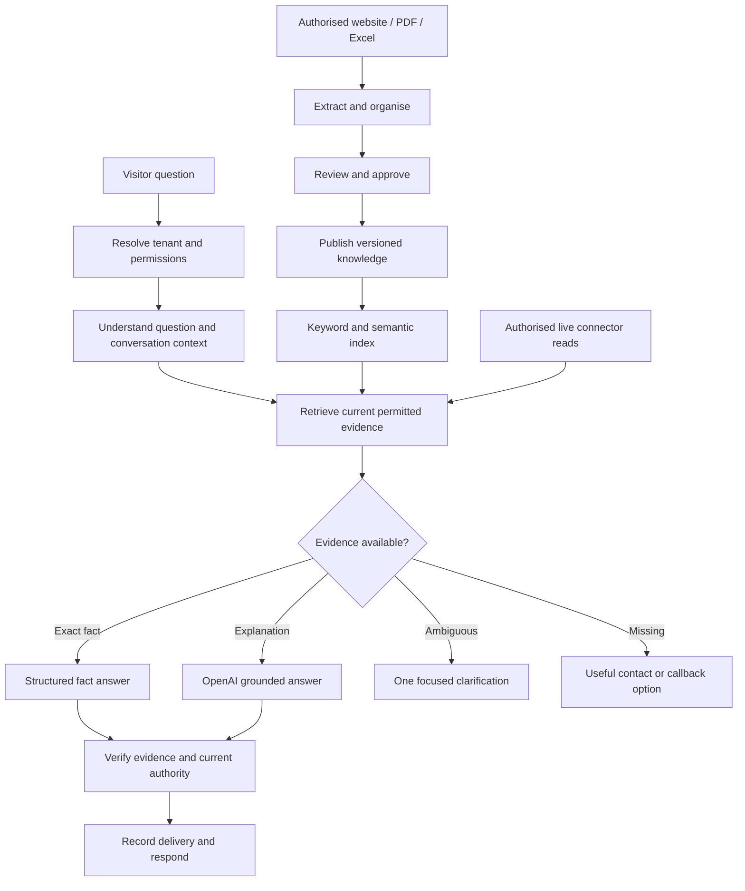

> 17 October 2026 — current-status notice: The design/evidence below is retained as a historical snapshot. It is not current architecture certification. Use [the current target](product-memory/AIFROGI_TARGET_AND_INSTRUCTIONS.md), [strategy/checklist](product-memory/AIFROGI_ARCHITECTURE_STRATEGY_AND_CHECKLIST.md), and [architecture work register](product-memory/AIFROGI_ARCHITECTURE_WORK_REGISTER.md). Older green claims and inconsistent summary counts must not be reported as today's completion percentage. Latest real-model results include proof and test-transport failures; the shared architecture remains unqualified.

# AiFrogi — Approved Shared RAG Architecture

Agreed with the owner: 3 October 2026 (Asia/Kolkata).

This document records the agreed architecture and its implementation boundary. Agreement approves the architecture; it does not certify the complete implementation or its production deployment.

## Implementation status

The shared RAG candidate now includes source-to-answer integration. It is **not deployed**. The answering test gate is now green; production rollout preflight and online validation remain pending. See the latest [fixed candidate report](../deliverables/RAG_FIXED_REPORT_2026-10-03.md). Earlier reports are retained as historical evidence.

| Capability | Status |
| --- | --- |
| One public factual engine for production properties with organisation scope | Implemented; no failed shared answer falls through to legacy facts |
| Conversation resolution, exact contacts, formatting preference, optional-stage fallback | Implemented |
| Independently approved PDF/Excel claims without an active crawl | Implemented and database tested |
| Mixed-source retrieval, immutable indexing and exact delivery receipts | Implemented and candidate tested |
| Owner review/publication, correction, reconfirmation and withdrawal | Implemented; seven lifecycle cases passed |
| Typed authorised live evidence | Public catalogue adapter implemented; private PMS/orders require separate integration |
| Original 15-question factual gate | 15/15 met unchanged criteria and source-review expectations; missing details handled explicitly |
| Additional contact/follow-up/missing-information cases | 6/6 supported |
| Broader regression suite | 821/821 passed |
| Production HTTP/Chrome checks | Pending |
| Future-dated publication activation | Requires republishing; scheduling remains unfinished |

## Objective

Every wired bot answers its own business questions naturally from permitted, current, approved evidence. Simple facts should be fast and exact. Broader questions should receive a grounded OpenAI explanation. Missing information must lead to a useful endpoint rather than repeated generic uncertainty or an endless clarification loop.

One shared answering engine, one approval system and one factual delivery path serve every tenant. Source adapters supply evidence; they do not become independent answering engines.

## End-to-end flow

## Components and responsibilities

| Component | Responsibility |
| --- | --- |
| Tenant boundary | Establish bot, business, visitor session and permissions before accessing knowledge. Enforce the same boundary in history, retrieval, connectors and cache. |
| Source ingestion | Extract authorised crawl, PDF and Excel through the existing ingestion workflow. Retain original passages and source locations. Repeated imports update a stable source identity instead of duplicating it. |
| Knowledge records | Store stable fact identities such as `contact.phone`, `location.address` and `training.offering`, alongside descriptive passages. Preserve source lineage, revision, approval, audience and effective dates. |
| Approval and publication | Uploaded content begins private. Owner approval publishes an immutable version. Superseded or conflicting records cannot silently become public answers. |
| Search index | Derive keyword and semantic indexes from published knowledge. An index accelerates retrieval; it grants no permission and is not another authoritative knowledge store. |
| Question understanding | Resolve synonyms, typos and relevant follow-ups with shared normalization and semantic retrieval. Recent tenant-scoped messages identify a subject, never establish business facts or action consent. |
| Retrieval | Combine keyword and semantic candidates. Apply permissions, relevance, field authority and effective-version selection. Optional reranker errors retain the original eligible results. |
| Live reads | Use an authorised connector for changing facts such as availability, stock or authenticated order status. Retain timestamp and access scope. Never substitute stale static data silently for a failed live read. |
| Answer composition | Return exact facts directly when possible. Otherwise use one OpenAI generation from retrieved evidence. Length is a formatting preference; repeated generation solely to shorten a factual answer is unnecessary. |
| Verification | Check factual support, citations, numbers, conditions and polarity once, then recheck authority before delivery. Keep independently supported requested parts when another detail is missing. |
| Delivery | Preserve verified answer bytes and record the evidence receipt. Maintain safety and action controls. A recoverable failure permits retry without invalidating the visitor session. |
| Measurement | Capture actual reply, retrieved passages, source versions, correctness assessment and per-stage/total latency. Record crawl-coverage gaps separately. |

## Source preference and freshness

Source preference is determined by the fact and the client's approval, not by file format or upload time alone.

| Question | Authority |
| --- | --- |
| Phone, address, policy or approved price | Client-designated authoritative record for that field |
| Services, training and explanations | Relevant current approved passages |
| Availability, stock or authenticated order status | Authorised live system with suitable freshness |
| Conflicting values of equal authority | Identify the specific conflict or ask one focused clarification |
| Missing business fact | Answer available parts and offer verified contact details |

A newer Excel upload does not automatically override an approved website address. A crawl does not override an owner-approved correction. Apply approval, field authority, effective dates, expiry and supersession before ranking relevance. Future-effective, expired, revoked, private and unpublished records are ineligible for the public bot.

Each published source revision must retain its source identity, captured time, approved version and validity. Recheck the relevant authority snapshot before delivery so a revoked source cannot be served from an earlier retrieval or cache entry.

## Retrieval, memory and caching

- Use structured lookup for exact fields and hybrid retrieval for explanations; both enter the same evidence contract and delivery path.
- Do not enumerate every possible question, synonym or typo manually. Shared field aliases and semantic retrieval handle variations.
- Deduplicate repeated imports by source identity and capture operation, and index entries by immutable claim version. An unchanged import must not create another active fact.
- Scope memory to the tenant and authorised visitor conversation. Clear subject assumptions when a visitor explicitly changes or corrects the topic.
- Any shared cache must include tenant, access scope, publication/source version and query identity. Invalidate or make entries unreachable after relevant publication, revocation or expiry. Request-local deduplication is already present; a global answer cache is not claimed as implemented.

## OpenAI's role

OpenAI understands intent and formulates a human answer from retrieved evidence. It must not invent client addresses, prices, policies, promises, transaction status or contact details. Retrieved text and visitor messages are untrusted data, not instructions overriding the engine.

General educational explanations may be allowed through an explicit business policy, clearly distinguished from client-specific facts. General model knowledge must not fill missing client records.

## Useful answers and recovery

Answer supported parts directly. Describe only the specific missing detail; do not contradict a factual answer with a generic statement that nothing is verified. Ask one focused clarification when it can resolve genuine ambiguity.

When evidence is missing, offer a relevant approved contact or callback option. Display an official phone number only when supported by current public evidence. Collect a callback number with consent and acknowledge a saved callback only after persistence succeeds. Do not force lead capture before answering an available business fact.

CTA buttons may include a verified source link, `Call`, or `Request callback`, when configured and applicable. Never invent URLs or imply that staff have connected, a booking is confirmed, or a payment succeeded without a verified result.

## Connectors and transactions

Read evidence and transaction execution have different authority. The answering engine may consume permitted typed connector reads. Booking, payment, cancellation and other writes remain separately authorised modules with their own validation and verified results. Approval of workbook payment information permits factual answers, not payment transactions.

Connector failure must be reported as inability to check the specific current value. It must not erase unrelated approved knowledge or trigger a retry loop. Tenant credentials and private connector data must not leak into another bot, public reply or model input outside their authorised scope.

## Migration without overlapping pipelines

1. Extend the existing canonical publication model and shared engine; do not create another knowledge store or approval system.
2. Replace crawl-only readiness with a canonical source/publication snapshot supporting independently approved PDF/Excel evidence.
3. Implement mixed-source delivery receipts without relabeling document claims as crawl chunks or weakening evidence authority.
4. Add idempotent semantic indexing by approved immutable document-claim version.
5. Integrate authorised typed live reads and complete field authority/freshness handling.
6. Repair the baseline HTTP test harness and pass the full candidate gate.
7. Select the unified engine explicitly for each bot. A failed unified answer must never fall through to the old factual pipeline.
8. Deploy only after the release gate, repeat approved tests online, then remove the retired factual path. Retain the previous release for rollback.

Every production property with an organisation identifier selects the shared engine. The retained legacy service body is limited to offline evaluation and incomplete synthetic fixtures; paraphrase and affirmative regression failures are now corrected without changing their criteria. A failed shared answer does not invoke that body.

## Acceptance gate and evidence

Run all 15 previously approved questions without changing questions or criteria. Also cover fresh paraphrases, address/phone/email, conversational follow-ups, topic changes, missing information, conflicting sources, effective dates, publication/revocation, tenant isolation, service outages, delivery retries and authorised live-read failures.

For every case save:

- Exact question and relevant conversation context.
- Actual returned reply and CTA actions.
- Actual retrieved passages, source identifiers and versions.
- Correctness and completeness assessment against the evidence.
- Authority, context, retrieval, optional reranking, composition, verification and delivery latency, plus total latency.
- Failure classification and separate content-coverage gaps.

Latest candidate validation: 821/821 regressions, 15/15 unchanged approved cases and six additional cases passed. The corrected comparison has 11 source-supported replies plus two safe missing-information replies per composition mode, with no reviewed failures. Two injected model-failure recoveries passed canonical database receipts. Earlier 12 database controls and seven owner lifecycle cases remain recorded, not rerun in this recovery. Production preflight and online rollout verification remain pending; exact replies and timing are in the fixed candidate report.

The onboarding aspiration is a bot answering its brand within four minutes after wiring and approved knowledge publication. This is a target requiring measurement, not an established guarantee. The 15-question checkpoint does not certify reliability across 1,000 bots.

## Release and rollback

Keep a concrete candidate commit, test evidence and a recoverable prior release before activation. Preserve database compatibility or provide a reviewed migration rollback strategy before any future schema change. Restore the corresponding previous application build and source snapshot, restart the existing service and verify readiness and approved questions if rollback is required.

This candidate includes a database migration replacing SQL functions and publication behaviour. Capture prior function definitions, grants, application build and a rehearsed database recovery point before release. Follow the detailed release/rollback procedure in the implementation report. Production remains unchanged.

## Existing-policy combination experiment

An isolated composition comparison is recorded in [quality report](../deliverables/ANSWER_ENGINE_COMPARISON_2026-10-03.md). Existing composition policy is reused through the same RAG adapter for a controlled reference; this is not a replay of the full old production engine. In 13 cases, existing-policy/RAG/combined produced 11/10/9 source-supported replies, with two coverage gaps in each mode and zero/one/two failures respectively. Combined mode remains trial-only and is not selected by production callers. Product entity binding and consistent partial-answer schemas remain required; policy merging alone is not a demonstrated improvement.

## Recovery of comparison failures

The latest [fixed report](../deliverables/RAG_FIXED_REPORT_2026-10-03.md) supersedes the failed comparison's current-status conclusions while preserving its raw evidence. Subject-scoped retrieval prevents cross-product detail transfer; disposition reconciliation preserves facts/missing parts; source-opening inventory checks preserve requested deliverables; generic paraphrase/affirmative routing and operating-hour recognition are corrected. Model composition/review failures may recover only an exact approved public phone after a fresh authority check, with a clear limitation and no model retry. Source metadata quality and upstream service availability remain practical limits, not guarantees.
